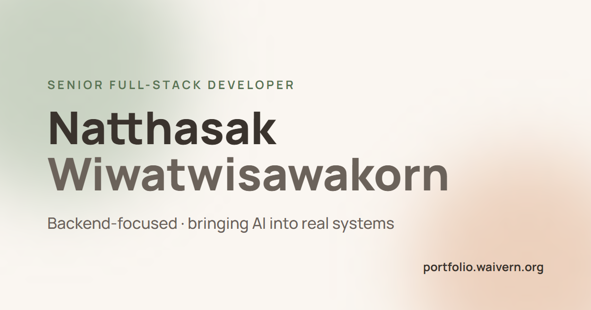
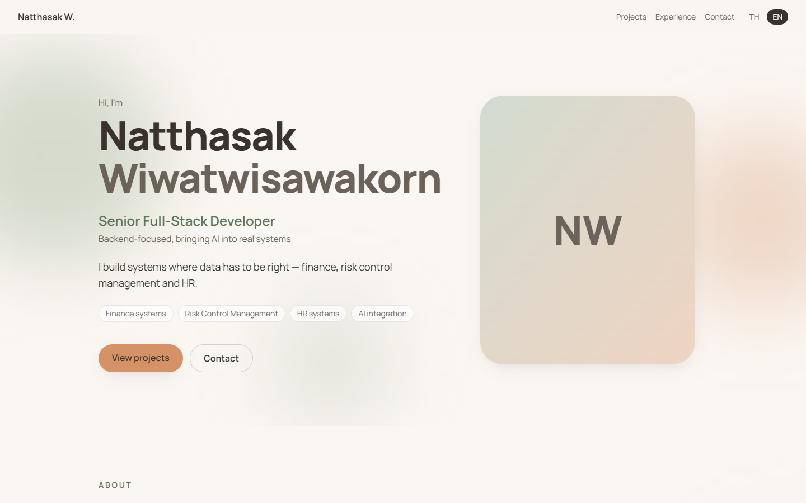
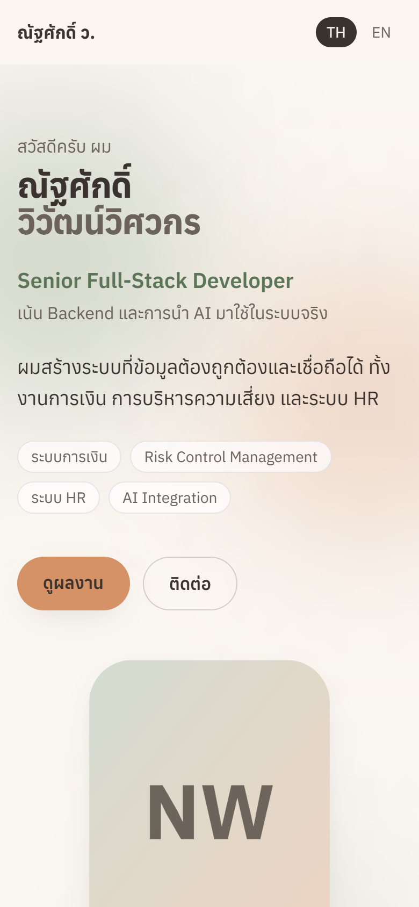

<div align="center">



# Natthasak Wiwatwisawakorn — Portfolio

Personal portfolio of a Senior Full-Stack Developer (backend + AI integration).
Single-page, bilingual (TH / EN), soft parallax — built to be fast and accessible.

**[portfolio.waivern.org](https://portfolio.waivern.org)**


</div>

---

<table>
  <tr>
    <td width="72%"></td>
    <td width="28%"></td>
  </tr>
</table>

## Highlights

- **Bilingual TH / EN** — every string lives in `src/i18n/*.json`; the chosen language is remembered
- **Soft parallax** — GSAP ScrollTrigger + Lenis smooth scroll, animating only `transform` / `opacity`
- **Respects the user** — `prefers-reduced-motion` turns every animation off; mouse tilt only on fine pointers
- **Design tokens** — one source of colour truth in `src/styles/tokens.css`, WCAG AA contrast checked
- **Measured, not guessed** — Lighthouse mobile 98 / 100 / 100 / 100, desktop 100 across the board, 0 axe violations ([QA report](docs/qa-report.md))

## Tech stack

| Layer | Choice |
|---|---|
| UI | React 19 · TypeScript · Vite |
| Styling | Tailwind CSS v4 + CSS-variable tokens |
| Motion | GSAP · @gsap/react · Lenis |
| i18n | i18next · react-i18next |
| Hosting | Cloudflare Pages |

## Project structure

```
├── public/               static files (og-image, robots.txt, sitemap.xml, _headers)
├── src/
│   ├── sections/         Hero · About · Projects · Experience · Contact
│   ├── components/       shared UI (language switch)
│   ├── motion/           useMotion() — all scroll & pointer animation in one hook
│   ├── i18n/             th.json · en.json · i18next setup
│   └── styles/           tokens.css (design tokens) · global.css
└── docs/
    ├── brief.md          goals and audience
    ├── design.md         direction, colour tokens, motion rules
    ├── qa-report.md      Lighthouse / axe / viewport results
    └── screenshots/
```

Sections never import GSAP — they only mark elements with `data-speed`, `data-reveal`, `data-line`, `data-count` or `data-tilt`, and [`useMotion`](src/motion/useMotion.ts) brings them to life.

## Getting started

```bash
npm install
npm run dev        # http://localhost:5173
npm run build      # type-check + production build to dist/
npm run preview    # serve the production build
```

Edit content in `src/i18n/th.json` and `src/i18n/en.json` — no component changes needed.

## Deploy

Pushing to `main` deploys automatically through Cloudflare Pages (build command `npm run build`, output `dist`).

## How it was built

Planned and built with [web-studio](https://github.com/nattawai/web-studio), a Claude Code plugin that runs a gated workflow:
Brief → Direction → Structure → Build → Motion → QA → Deploy. Progress and decisions are logged in [STATUS.md](STATUS.md).

## License

Code is released under the [MIT License](LICENSE).
Personal content — name, biography, work history, photos and the og-image — © Natthasak Wiwatwisawakorn, all rights reserved.
